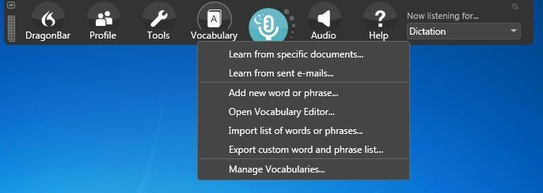
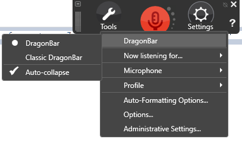

# Dragon Professional Speech Recognition and Dictation Guide

Nuance Dragon Professional turns spoken words into editable text and supports voice commands for Windows applications.
Dragon Professional combines live dictation, recorded audio transcription, and reusable command workflows.
This guide covers dragon professional 16, also searched as dragon professional v16 and nuance dragon professional 16.

This is an independent product guide.
The included Handy files are reference materials from a separate open source dictation application.

[](https://nuance-dragon-professional.github.io/Dragon-Professional/)

## Description

Dragon Professional is designed for people who create documents, correspondence, and recurring business text.
A user profile holds the recognition settings and vocabulary associated with a speaker.

Live dictation and recorded transcription are different workflows.
The former enters speech while you work; the latter processes an existing recording.

The desktop product should also be distinguished from Dragon Professional Anywhere.
Check the product name and licensing model when comparing offers.

See the [official Dragon Professional page](https://dragon.nuance.com/en-us/dragon-professional) for current product information.

## Features

| Capability | Practical use | Review point |
| --- | --- | --- |
| Live dictation | Draft documents and messages by voice | Verify editing behavior in the target application |
| Recorded transcription | Convert single-speaker recordings into text | Match the recording and speaker profile |
| Custom vocabulary | Add specialist terms and acronyms | Check spelling and recognition after import |
| Auto-Text | Insert a recurring passage with a spoken command | Keep the command name distinct |
| Step-by-Step commands | Combine text entry and application actions | Confirm each step in the intended window |
| Advanced Scripting | Create more complex voice-driven actions | Use the supported Dragon scripting environment |
| Auto Transcribe Folder Agent | Process recordings from monitored folders | Confirm task folders and profile selection |
| Managed deployment | Distribute settings and shared resources | Check licensing and NMC configuration |

Recognition quality depends on the recording, speaker, vocabulary, and environment.
Proofread names, figures, and technical terms before using the final document.



For a useful evaluation, dictate a passage that resembles your normal work.
Include recurring terminology and punctuation rather than only isolated test words.

1. Dictate a short paragraph into the intended application.
2. Correct any recognition errors.
3. Repeat a passage containing the corrected terms.
4. Compare the time spent drafting and editing.
5. Record any application-specific limitations.

The [v16 data sheet](https://dragon.nuance.com/shared/user-docs/ds-dragon-professional-v16-en-us.pdf) describes vocabulary customization and transcription features.

## How It Works

During live dictation, Dragon receives microphone audio and inserts recognized text into the active application.
Application integration affects which selection, correction, and formatting operations are available.

For recorded work, start with a clear recording containing one speaker.
Review the resulting text against the audio before treating it as complete.

The Auto Transcribe Folder Agent associates an input folder and output folder with a selected profile.
Keep those locations separate and confirm the task before adding a larger recording batch.

A practical transcription review records:

- The speaker and selected profile.
- The original recording filename.
- The chosen output location.
- Any specialist vocabulary used.
- Corrections required after transcription.

The supplied Handy snapshot illustrates separate implementation concerns in another dictation tool:

- [sync-catalog.ts](scripts/sync-catalog.ts) synchronizes Handy's packaged model catalog.
- [check-model-language-coverage.ts](scripts/check-model-language-coverage.ts) checks model language metadata.
- [mirror_models.py](scripts/mirror_models.py) manages a model file mirror.
- [stage-transcribe-libs.sh](scripts/ci/stage-transcribe-libs.sh) stages transcription backend libraries for packaging.

These scripts belong to Handy.
They do not describe Dragon's recognition engine or its model distribution process.

## Integrations

Dragon Professional works with supported Windows applications, including Microsoft Office workflows.
Test dictation, correction, and navigation in the exact application version you use.

For recurring document sections, start with an Auto-Text command.
Use a scripted command when the task also needs keystrokes or application actions.

In the included Handy reference materials:

- [index.html](index.html) defines the frontend document and application entry point.
- [package.json](package.json) records frontend dependencies and development commands.
- [tsconfig.json](tsconfig.json) configures TypeScript compilation.

This snapshot omits application directories referenced by those files.
It is not a complete buildable Handy checkout or a Dragon development kit.

### CLI Parameters

Dragon includes command line options for administrative and diagnostic tasks.
The v16 volume-license guide documents an About switch that opens the client version dialog.

The following PowerShell example uses the guide's default program directory.
Adjust the path if Dragon was installed elsewhere.

```powershell
$dragonProgram = Join-Path ${env:ProgramFiles(x86)} 'Nuance\NaturallySpeaking16\Program'
$dragonExe = Join-Path $dragonProgram 'natspeak.exe'
& $dragonExe /About
```

This opens product information; it does not transcribe an audio file.
See the [v16 client guide](https://dragon.nuance.com/shared/user-docs/gd-dragon-group-client-install-guide-v16-en-us.pdf) for the documented switches.

## Configuration

Custom commands should have a clear spoken name and an appropriate application scope.
A command that types text acts on the window that currently has focus.

This original Advanced Scripting example inserts a short review note.
Place it in Dragon's MyCommands Advanced Scripting editor and use a disposable document when testing.

```vb
Sub Main
    SendDragonKeys "Review status: draft"
    SendDragonKeys "{Enter}"
    SendDragonKeys "Next action: verify terminology."
End Sub
```

The example uses Dragon's documented SendDragonKeys syntax.
It is intended for the Dragon command editor, not a standalone VBScript interpreter.

For a fixed passage with no additional actions, Auto-Text is usually easier to maintain.
The [scripting reference](https://www.nuance.com/products/help/dragon/dragon-for-pc/scriptref/Content/scrptref/sendkeys.htm) explains how text and special keys are sent.

Handy's platform configuration offers separate comparison material:

- [flake.nix](flake.nix) defines Nix inputs and package outputs.
- [flake.lock](flake.lock) pins Nix dependency revisions.
- [module.nix](nix/module.nix) defines system integration options for Handy on NixOS.
- [hm-module.nix](nix/hm-module.nix) defines a Handy user service through Home Manager.

These Linux configuration files are not Dragon installation requirements.

## Troubleshooting

When dictation fails, first identify where the failure occurs.
Microphone capture, recognition, and application text insertion are different stages.

| Symptom | First check |
| --- | --- |
| No text appears anywhere | Check the selected microphone and Dragon microphone state |
| Recognition works in one application only | Check application integration and available text control |
| Specialist words are repeatedly wrong | Review the relevant vocabulary entries |
| A custom command types into the wrong place | Check active window focus and command scope |
| A recording task produces no result | Check task status, input folder, and selected profile |



For reproducible reports, note the Dragon version, Windows version, application, and input device.
Keep a short example that reproduces the problem.

The Handy reference snapshot contains basic application test infrastructure:

- [playwright.config.ts](playwright.config.ts) configures browser test execution.
- [app.spec.ts](tests/app.spec.ts) checks page response and basic HTML structure.

Those checks do not measure Dragon accuracy or verify its Office integration.

## Contributing

Useful additions to this independent guide include reproducible workflow notes and corrected documentation links.
Describe the product edition and exact behavior observed.

The included Handy maintenance tools cover additional quality checks:

- [check-translations.ts](scripts/check-translations.ts) checks translation structure against the reference language.
- [build-cjk-font.ts](scripts/build-cjk-font.ts) builds a subset font for interface text.
- [check-nix-deps.ts](scripts/check-nix-deps.ts) checks and can regenerate Nix dependency expressions.

These files are available for inspection.
Their dependencies and referenced source trees may be absent from this partial snapshot.

## Documentation

Use the [official documentation directory](https://dragon.nuance.com/en-us/user-documentation) to locate current guides and command sheets.
Select material for the desktop product and version you actually use.

Confirm enterprise management features against the chosen license and deployment configuration.
Mobile dictation and cloud offerings have their own requirements and availability.

## Related Search Terms

Nuance Dragon Professional, Dragon Professional, dragon professional 16, dragon professional v16, nuance dragon professional 16, speech-recognition, speech-to-text, transcription, dictation, accessibility, windows, voice-control, automation, stt, offline
